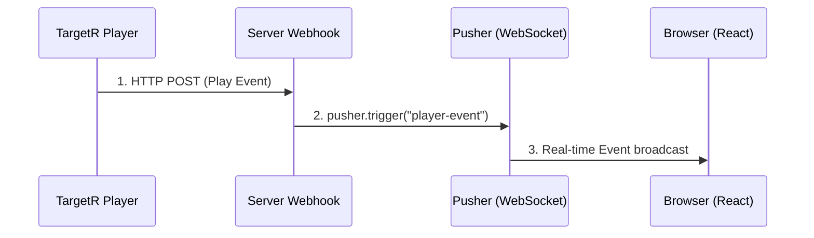

# TargetR Direct Proof of Play (DPoP) API

API สำหรับยืนยันการเล่นโฆษณาแบบเรียลไทม์ (Broadcaster & Advertiser-Grade Play Verification) เพื่อใช้ทำระบบคิดเงินโฆษณาแบบ Programmatic

## ⚙️ หลักการทำงาน

1. เมื่อหน้าจอ (Player) เล่นมีเดียไอเทมที่กำหนดสำเร็จ ตัวระบบ Player จะทำการยิง **HTTP POST** ตรงกลับไปที่ Server Endpoint ปลายทางของลูกค้าที่ตั้งค่าไว้ทันที
2. รองรับการทำงานแบบออฟไลน์ หากเครือข่ายหลุด ข้อมูลจะถูกเก็บไว้ที่เครื่องและส่งกลับแบบ Batch เมื่อระบบกลับมาออนไลน์

## 📦 Payload Options

*   **Data Logs**: ข้อมูลดิบประวัติวันเวลาและไอดีการแสดงผล
*   **Summaries**: สรุปข้อมูลยอดชม/ยอดเล่นของโฆษณา
*   **Screenshots**: ภาพหน้าจอ (Screenshot capture) ณ วินาทีที่ระบบเล่นมีเดีย เพื่อใช้เป็นหลักฐานยืนยันความถูกต้องสูงสุด

---

## 🏗️ โครงสร้างสถาปัตยกรรมระบบ (Architecture)

การใช้ DPoP เพื่อทำระบบแสดงผลพรีวิวมีเดียแบบ Real-time บนหน้าแดชบอร์ด จะต้องใช้การทำงานร่วมกัน 3 ส่วน:



### 1. ลงทะเบียนช่องทางส่งข้อมูล (DPoP Endpoint Registration)
ใช้ API ของ TargetR หรือ Stacks ในการกำหนดว่าให้ Player ตัวใดบ้าง ส่งข้อมูลกลับมาที่เซิร์ฟเวอร์ของเรา:
```javascript
// ตัวอย่างกำหนดให้ Player ยิง DPoP มาที่ Webhook Server ของเรา
const data = await bulk_data_update(
  ["MAC_ADDRESS_1"],
  "https://your-domain.com/api/pusher",
  "SHORT"
);
```

### 2. เซิร์ฟเวอร์รับ Webhook (Server Webhook)
เซิร์ฟเวอร์ต้องเตรียม API endpoint เพื่อรองรับ **HTTP POST** จากตัวเครื่องเล่น เมื่อเครื่องเล่นเปลี่ยนคอนเทนต์ มันจะส่งข้อมูลเข้ามา จากนั้นเซิร์ฟเวอร์จะบรอดแคสต์ข้อมูลต่อด้วย **Pusher (WebSockets)** ไปหาเบราว์เซอร์ของผู้ใช้:

```javascript
// ตัวอย่างไฟล์: app/api/pusher/route.js
import { NextResponse } from "next/server";
import Pusher from "pusher";

const pusher = new Pusher({
  appId: process.env.PUSHER_APP_ID,
  key: process.env.PUSHER_KEY,
  secret: process.env.PUSHER_SECRET,
  cluster: process.env.PUSHER_CLUSTER,
  useTLS: true,
});

export async function POST(req) {
  const body = await req.json(); // ข้อมูล DPoP ส่งมาจาก Player

  // ยิงส่งต่อให้เบราว์เซอร์ที่เปิดหน้าเว็บอยู่แบบ Real-time
  await pusher.trigger("monitor_screen", "player-event", body);
  
  return NextResponse.json({ success: true });
}
```

### 3. เบราว์เซอร์รับข้อมูล (Client WebSocket Consumer)
ทางฝั่งหน้าจอ Monitor (React/Next.js) จะทำการเปิดการเชื่อมต่อ WebSocket ด้วย `pusher-js` เพื่อดึงข้อมูลมาแสดงผลพรีวิวแบบเรียลไทม์:

```javascript
import Pusher from "pusher-js";

React.useEffect(() => {
  const pusher = new Pusher(process.env.NEXT_PUBLIC_PUSHER_KEY, {
    cluster: process.env.NEXT_PUBLIC_PUSHER_CLUSTER,
  });

  const channel = pusher.subscribe("monitor_screen");

  channel.bind("player-event", async (payload) => {
    const { screenId, libraryItemId } = payload;
    console.log("ได้รับข้อมูลการเล่นสด:", screenId, libraryItemId);
    // อัปเดตรูปภาพพรีวิวบนหน้าจอแผนที่
  });

  return () => {
    channel.unsubscribe();
    pusher.disconnect();
  };
}, []);
```

