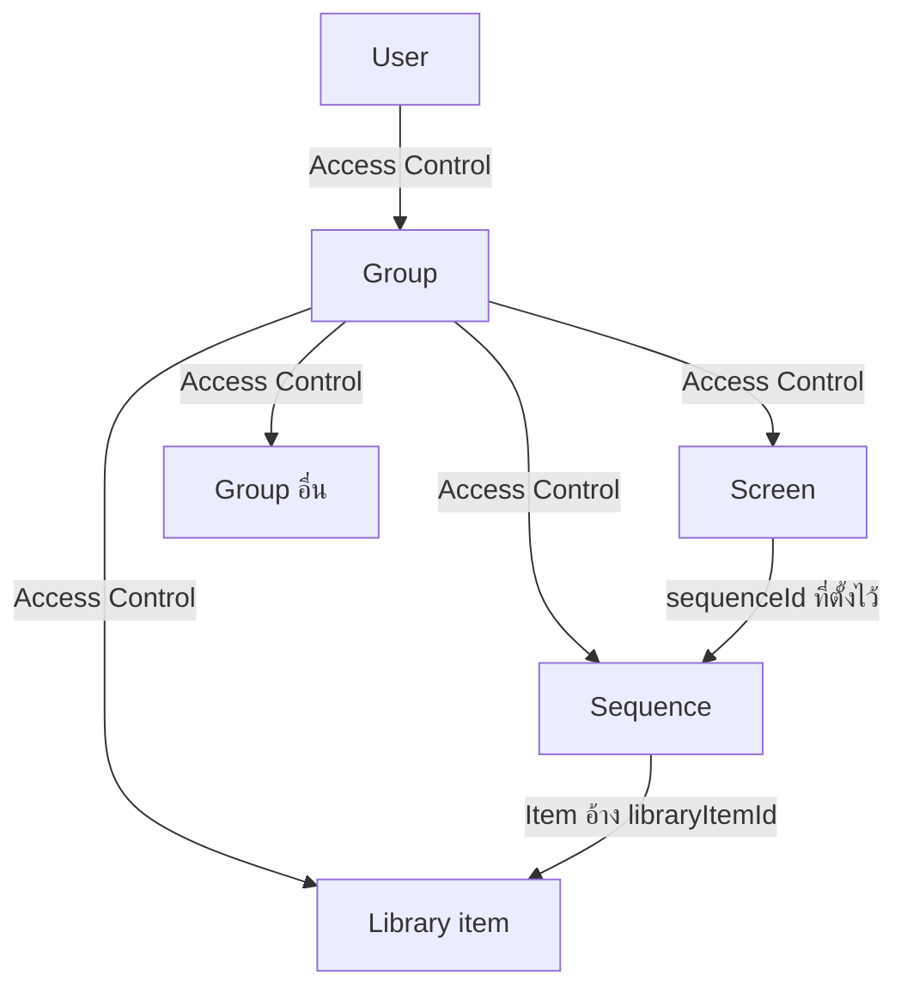

# TargetR Group และ Access Control: ความสัมพันธ์ไม่ใช่ปิรามิด

**Access Control เป็นเส้นเชื่อมระหว่างผู้ถือสิทธิ์กับรายการ ไม่ใช่ชั้นบนสุดของ Screen/Sequence/Library item** ความสัมพันธ์การจัดกลุ่ม/สิทธิ์กับความสัมพันธ์การตั้งค่าเล่นสื่อเป็นคนละเรื่อง

- Access Control **หนึ่งรายการระบุหนึ่งความสัมพันธ์**: `actorType` + `actorId` (ผู้ใช้หรือ Group) → `objectType` + `objectId` (รายการปลายทาง เช่น Screen, Sequence, Library item หรือ Group)
- ฟิลด์ที่ตรวจจริงจาก `GET /rest-api/v1/accesscontrol`: `id`, `type`, `actorType`, `actorId`, `objectType`, `objectId`, `modifiedMillis` และ `readOnly` ซึ่งไม่ใช่ทุกแถวมี; **ไม่มี `data` ซ้อนแบบ Screen** อย่าเดาสิทธิ์จากการไม่มี `readOnly`
- JSON ของ Group เองไม่มีรายการ ID สมาชิก และ `data` ของ Screen/Sequence/Library item ไม่จำเป็นต้องมี Group ID ชั้นกลางคือ Access Control ตาม [คู่มือ RESTful API](https://support.targetr.net/hc/en-gb/articles/360006429057-RESTful-API)
- คู่มือรองรับการอ่านรายการใน Group ด้วย `?groupId=` หรือ `?groupName=` สำหรับ list endpoint เช่น `/rest-api/v1/screens` โดยไม่ต้องนำข้อมูลสิทธิ์ดิบทั้งหมดไป join เอง ต้องคุมสิทธิ์ของผู้ถามเสมอ
- มีความสัมพันธ์ Group → Group ใน snapshot แต่ **ยังไม่ยืนยันกติกาการสืบทอดสิทธิ์** อย่าอนุมานสมาชิกทางอ้อม
- API มี JSON และฟิลด์ `data` แบบยืดหยุ่น แต่ **ยังบอกไม่ได้ว่า backend ของ TargetR ใช้ SQL หรือ NoSQL**; Access Control คล้ายแถวความสัมพันธ์ ส่วน `data` คล้าย document ไม่ใช่หลักฐานว่าใช้ฐานข้อมูลชนิดใด

**หลักฐาน:** คู่มือทางการข้างต้น และผลตรวจ API แบบอ่านอย่างเดียวเมื่อ 2026-09-28; ตรวจโครงสร้างโดยไม่เก็บ access controls ดิบหรือ ID จริงลงถัง
